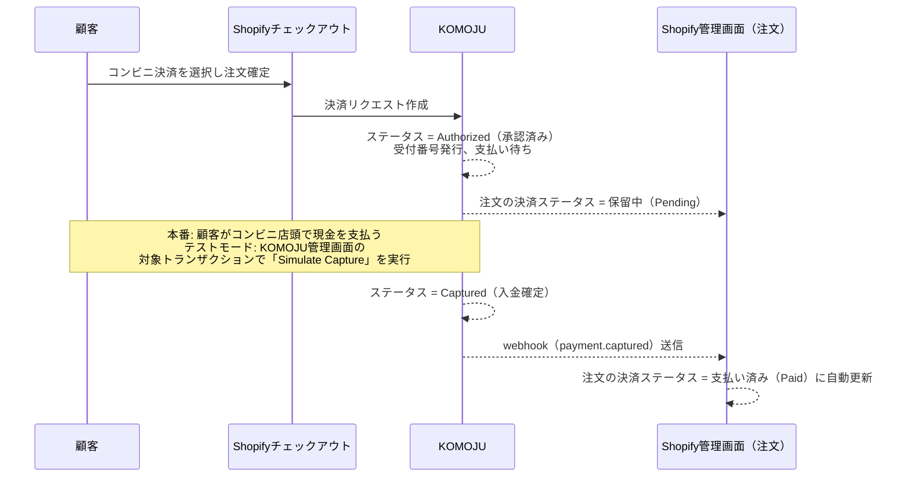

# KOMOJU導入と発送までの運用フロー

関連: Issue #2（コンビニ決済の採用検討）

## 目的

コンビニ決済の決済代行業者として採用候補に挙げた[KOMOJU](./checkout.md#コンビニ決済の決済代行業者比較実機確認公式情報ベンダー資料調査)について、実際にDevストアへ導入し、「顧客がコンビニ決済で購入した場合、管理者側では発送までどのような運用になるか」を検証する。

## 検証状況（2026-10-10時点）

KOMOJUのアカウント作成・Shopify Devストアとの連携・テストモードでのコンビニ決済注文は、**ユーザー自身がブラウザで実施し、完了した**（Claude側のブラウザ操作手段が使えないため、サインアップ・OAuth連携は人間側の作業とした。経緯は本ドキュメント初版の記録を参照）。これにより「支払い保留中 → 支払い済み」への切り替わりタイミングを実機で確認できた。

### 支払いステータスが切り替わるまでのフロー

テストモードでコンビニ決済を使ったチェックアウトを行うと、次の流れで状態が遷移する。

**要点**:

- KOMOJUの「承認済み（Authorized）」は、コンビニ決済では「顧客がまだコンビニで支払っておらず、支払い待ちの状態」を意味する。クレジットカードのオーソリとは異なり、この時点では資金はまだKOMOJUに入っていない
- Shopify側の注文は、KOMOJU側が Authorized のあいだは「決済保留中（Pending）」のまま。これは正常な挙動で、異常や連携不備ではない
- 顧客が実際にコンビニで支払いを完了する（テストモードでは、KOMOJU管理画面で該当トランザクションを開き「Simulate Capture」ボタンを押す）と、KOMOJU側のステータスが Authorized → Captured に変わる
- Captured になると `payment.captured` というwebhookがKOMOJUからShopifyに送信され、ここで初めてShopify側の注文の決済ステータスが自動的に「支払い済み」に切り替わる。マーチャント側の手動操作は不要（代引き・銀行振込の「手動決済方法」とはこの点が異なる）

## 実機確認できたこと: 支払い未確定の注文でも発送はシステム的にブロックされない

KOMOJU固有の検証はできなかったが、依頼の核心（「支払いが確定する前に発送してしまわないか」）に対しては、Shopify自体のAdmin API挙動として実機確認ができた。KOMOJUに限らず、代引き・銀行振込を含むあらゆる手動決済方法・保留中決済に共通する重要な事実のため、ここに記録する。

### 実機確認の手順と結果

`shopify store execute`（Admin GraphQL）で `rice-market-dev.myshopify.com` 上に検証用注文を作成・操作した（検証後は `orderDelete` で削除済み）。

1. `draftOrderComplete` に `paymentPending: true` を渡すと、`gateway: "manual"` の `SALE` トランザクションが `status: PENDING` で作成され、注文の `displayFinancialStatus` は `PENDING` になった（注文 #1008）
2. **この `displayFinancialStatus: PENDING` の注文に対して `fulfillmentCreate` を実行したところ、`userErrors` なしで成功し、`fulfillment.status: SUCCESS` が返った。** 実行後に注文を再取得すると `displayFinancialStatus: PENDING` / `displayFulfillmentStatus: FULFILLED` が同時に成立していた

また、本検証のために作為的に作ったものではない既存データとして、2026-09-20作成・2026-10-02にフルフィルメント済みの注文 `#1001`（Issue #44関連の別検証の副産物）も同様に `displayFinancialStatus: PENDING` かつ `displayFulfillmentStatus: FULFILLED` という状態で現存していることを確認した。

### 一次情報（shopify.dev）による裏付け

- `paymentSessionPending` ミューテーションの仕様に「`pendingExpiresAt` は3日以内が推奨（recommended to be within 3 days）」とある。これは[KOMOJUのドキュメント](./checkout.md)にある「Shopifyの支払いセッションは72時間で期限切れ」という理解と整合する。ただしこれは実装側（決済アプリ側）が設定する推奨値であり、Shopifyが一律72時間で強制失効させるハード上限であるとまでは、この記述だけでは言い切れない
- payments-apps向けドキュメントには「支払い保留中（pending payment）状態の注文は、支払いが確定するまで編集・キャンセル・手動キャプチャが制限される場合がある」という記載があるが、**発送（fulfillment）が制限されるとはどこにも書かれていない**
- マーケットプレイス連携の設計ガイド（`track-orders-other-platforms`）には、サードパーティ・マーケットプレイス経由の注文について「決済は自動キャプチャされない。マーチャントは支払いがキャプチャされる前に注文を発送しなければならない（transaction captureはfulfillmentの後に発生する設計）」という、むしろ「支払い確定前に発送する」ことを前提とした公式のベストプラクティスが明記されている

### 結論

**Shopifyのシステムは、支払いが`PENDING`のままの注文であっても、管理者が発送操作（fulfillment作成）を行うことをAPIレベルで技術的にブロックしない。** KOMOJU側が案内する「支払いのオーソリ確認後に発送する」というベストプラクティスは、Shopifyのシステムによる強制ではなく、**マーチャント側の運用判断に委ねられている**。

これは代引き・銀行振込（既存の手動決済方法）にもそのまま当てはまる。発送前に支払い確認を行うかどうかは、Shopify側の機能ではなくマーチャントの運用ルール・チェック体制次第であり、「うっかり未入金のまま発送してしまう」ことを防ぐ仕組みはShopify標準には存在しない。運用マニュアル（出荷前チェックリスト等）で担保する必要がある。

なお、これはAPIレベルでの確認であり、管理画面のボタン名・画面表示文言そのもの（ブラウザUI上の警告表示の有無など）は未確認。

## 未確認のまま残っている項目

- KOMOJU管理画面のTransactionsページでのShopify注文との突き合わせ方法（Payment IDでの検索）の実際の操作感
- 支払い期限切れ時の、Shopify・KOMOJU両方での実際のキャンセル操作画面
- Live mode（本番）移行に必要な審査の実際の内容・期間

## 運用ドキュメントへの反映について

この調査結果を含む決済まわりの検証内容は、別途まとめて納品用の運用ドキュメントとして整理される予定（ユーザー側で対応）。本ファイルは調査の一次記録として残す。
